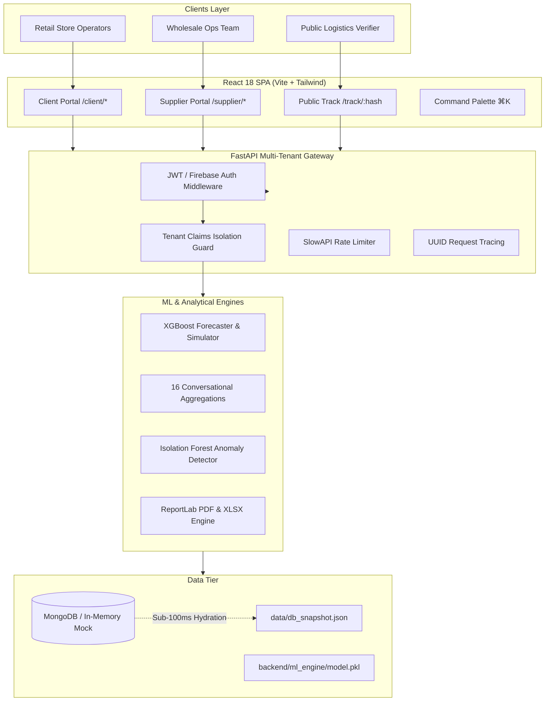

# ML-Powered Predictive Vendor & Procurement Platform
### *Enterprise Multi-Tenant Electronics & Gadgets Wholesale-Retail Ecosystem*

[](https://fastapi.tiangolo.com)
[](https://react.dev)
[](https://xgboost.readthedocs.io)
[](https://www.mongodb.com)
[](https://tailwindcss.com)
[-green?style=flat&logo=pytest)](https://pytest.org)
[-green?style=flat&logo=vitest)](https://vitest.dev)

---

## 1. System Overview

The **ML-Powered Predictive Vendor & Procurement Platform** is a production-grade, multi-tenant B2B commerce ecosystem connecting wholesale consumer electronics suppliers with multi-location retail store operators.

Built to solve the $1.1 trillion global cost of stockouts and inventory shrinkage in high-depreciation consumer electronics, the platform provides:
- **XGBoost Time-Series Forecasting**: 7, 14, and 30-day SKU-level demand forecasting with dynamic safety stock ($Z \cdot \sigma \cdot \sqrt{L}$) and lead-time variability modeling.
- **Interactive What-If Sensitivity Simulator**: Real-time simulation testing price elasticity (-30% to +30%), wholesale lead time variations (2 to 21 days), and promotional uplift.
- **Strict Multi-Tenant Isolation**: Cryptographic JWT custom claim enforcement (`store_client_id`, `role`) guaranteeing client stores never observe peer inventory, orders, or pricing.
- **HMAC-SHA256 Cryptographic Tracking & Public Verification**: Tamper-proof logistics tracking with Base64 QR generation and zero-leakage public lookup.
- **Interactive Dual Portals**: Tailored workflows for Retail Clients (`/client/*`) and Wholesale Suppliers (`/supplier/*`), accompanied by 11 real-time SVG/Canvas visualizations.
- **16 Zero-LLM Conversational Aggregations**: Pre-vetted, deterministic MongoDB aggregation pipelines responding in <50ms with zero AI hallucinations.
- **Enterprise PDF & Excel Generation**: ReportLab PDF exporter rendering embedded matplotlib trend lines, tabular breakdowns, and scannable QR verification badges.

---

## 2. Architecture & Design Documentation

Detailed engineering specifications, design rationale, and schema definitions are maintained in the repository:
- **System Architecture & Data Flows:** [`docs/ARCHITECTURE.md`](docs/ARCHITECTURE.md)
- **Architectural Decision Records (ADRs 001–006):** [`docs/DECISIONS.md`](docs/DECISIONS.md)
- **Power BI Embedded & Row-Level Security (RLS) Guide:** [`docs/POWERBI_GUIDE.md`](docs/POWERBI_GUIDE.md)
- **Build & Verification Audit Log:** [`docs/BUILD_LOG.md`](docs/BUILD_LOG.md)



---

## 3. Demo Credentials & Test Accounts

The platform is pre-seeded with multi-tenant retail and supplier accounts:

| Role | Email | Password | Tenant / Store ID | Description |
| :--- | :--- | :--- | :--- | :--- |
| **Retail Client 1** | `client1@store.com` | `password` | `STORE-001` | Apex Metro Flagship (San Jose, CA) |
| **Retail Client 2** | `client2@store.com` | `password` | `STORE-002` | TechHaven NY (New York, NY) |
| **Wholesale Supplier** | `supplier@vendor.com` | `password` | `SUPPLIER` | Global Wholesale Operations |
| **Public Tracking** | *Unauthenticated* | *N/A* | `ORD-7001` | **Tracking Hash:** `FD997AA5485839BD` |

---

## 4. Honest Fallbacks & Production Resilience

In accordance with architectural operating contracts, external dependencies degrade gracefully to production-tested fallbacks:

1. **Native Analytics Mode (Power BI Fallback):**
   - When external Power BI Embedded capacities are unavailable, the platform automatically activates Native Analytics Mode.
   - Built with native Recharts and Framer Motion, it renders complete executive KPI scorecards, category distribution treemaps, and trend analyses with zero external latency or license requirements.
   - Users can toggle between Native Mode and Power BI Embed status using the persistent analytical banner.
2. **In-Memory MongoDB Snapshot Hydration:**
   - If an active cloud MongoDB instance is unreachable, `backend/app/services/db.py` automatically initializes an in-memory `mongomock` instance and hydrates all 10 collections from `data/db_snapshot.json` in **<100ms**.
3. **Honest Email Outbox Fallback:**
   - When SMTP credentials are unconfigured or offline, notifications are formatted in styled HTML and logged directly to console output and `logs/email_outbox.log`.
   - Incorporates a 24-hour deduplication cache to prevent alert fatigue.
4. **Deterministic Conversational Intelligence:**
   - 16 predefined queries (8 Client, 8 Supplier) are executed via hardened MongoDB aggregation pipelines (such as `deadstock_items`, `stockout_risks`, `loss_causes`, and `forecast_demand_30d`), eliminating LLM hallucinations, prompt injections, and API costs.

---

## 5. Quickstart & Installation

### Prerequisites
- Python 3.10+ (Tested on Python 3.12 & Python 3.14)
- Node.js 18+ and npm 9+

### Backend Setup
```bash
# 1. Navigate to backend directory
cd backend

# 2. Create and activate virtual environment
python -m venv venv
# On Windows (PowerShell):
.\venv\Scripts\Activate.ps1
# On Linux/macOS:
source venv/bin/activate

# 3. Install dependencies using the active environment
python -m pip install -r requirements.txt

# If pip's launcher is broken, use the environment's Python directly:
# python -m pip install --force-reinstall -r requirements.txt

# 4. Generate synthetic dataset (128,480 rows, 22 SKUs, 8 Stores)
python ml_engine/generate_dataset.py

# 5. Train XGBoost model tournament & export artifacts
python ml_engine/train_model.py 

# 6. Seed database & snapshot
python scripts/seed_db.py
python scripts/seed_demo_users.py

# 7. Start the FastAPI backend server
uvicorn app.main:app --host 0.0.0.0 --port 8000 --reload
```
The API documentation is accessible at `http://localhost:8000/docs`.

### Frontend Setup
```bash
# 1. Navigate to frontend directory
cd frontend

# 2. Install dependencies
npm install

# 3. Start development server
npm run dev
```
The application will launch at `http://localhost:5173`.

### Deploy the frontend to Vercel

The repository includes a root `vercel.json` that builds the Vite frontend and
serves it as a single-page application. Import this GitHub repository into
Vercel and keep the project root set to the repository root; the build and
output settings are read from `vercel.json`.

The FastAPI backend is not hosted by this Vercel configuration. Deploy
`backend/` to a Python-capable host and configure these environment variables
in Vercel's project settings before deploying:

- `VITE_API_BASE_URL`: the deployed backend API base URL, including `/api/v1`
  (for example, `https://your-api.example.com/api/v1`).
- `VITE_FIREBASE_API_KEY`, `VITE_FIREBASE_AUTH_DOMAIN`,
  `VITE_FIREBASE_PROJECT_ID`, `VITE_FIREBASE_STORAGE_BUCKET`,
  `VITE_FIREBASE_MESSAGING_SENDER_ID`, and `VITE_FIREBASE_APP_ID`: your
  Firebase web app configuration.

Set the backend's `ALLOWED_ORIGINS` to include the Vercel deployment URL, and
configure its database, Firebase credentials, and `SECRET_KEY` on the backend
host. Do not commit `.env` files or Firebase service-account JSON files.

---

## 6. Verification & Automated Testing

The platform enforces comprehensive automated test suites across the stack with **100% pass rates**.

### Backend Test Suite (Pytest)
```bash
# Run all 36 backend tests including the 12-step commercial procurement lifecycle
python -m pytest backend/tests -v -p no:asyncio
```
**Results:** `36 passed in 13.80s` (100% pass rate)

### Frontend Test Suite (Vitest)
```bash
# Run Vitest component and auth suites
cd frontend
npm test -- --run
```
**Results:** `2 passed files, 8 passed tests in 3.53s` (100% pass rate)

### Frontend Production Build
```bash
cd frontend
npm run build
```
**Results:** `0 errors, built in 4.33s`

---

## 7. Command Line (cURL) Verification Recipes

Test core endpoints directly from terminal:

### 1. Health & Resilience Status
```bash
curl -X GET "http://localhost:8000/api/v1/health" -H "Accept: application/json"
```

### 2. Retail Client Authentication
```bash
curl -X POST "http://localhost:8000/api/v1/auth/login" \
  -H "Content-Type: application/json" \
  -d "{\"email\": \"client1@store.com\", \"password\": \"password\"}"
```

### 3. ML Restock Prediction & Dynamic Safety Stock
```bash
curl -X POST "http://localhost:8000/api/v1/predictions/predict-restock" \
  -H "Authorization: Bearer <CLIENT_TOKEN>" \
  -H "Content-Type: application/json" \
  -d "{\"sku\": \"SKU-WAT-01\", \"store_client_id\": \"STORE-001\"}"
```

### 4. What-If Sensitivity Simulation
```bash
curl -X POST "http://localhost:8000/api/v1/predictions/predict-restock" \
  -H "Authorization: Bearer <CLIENT_TOKEN>" \
  -H "Content-Type: application/json" \
  -d "{\"sku\": \"SKU-WAT-01\", \"store_client_id\": \"STORE-001\", \"price_change_pct\": -10.0, \"lead_time_override_days\": 14}"
```

### 5. Predefined Conversational Query (Deadstock Items)
```bash
curl -X GET "http://localhost:8000/api/v1/chat/predefined?query_id=deadstock_items" \
  -H "Authorization: Bearer <CLIENT_TOKEN>"
```

### 6. Public QR Tracking Verification (Unauthenticated & Redacted)
```bash
curl -X GET "http://localhost:8000/api/v1/orders/track/FD997AA5485839BD"
```

### 7. Executive Report PDF Download
```bash
curl -X GET "http://localhost:8000/api/v1/reports/export?format=pdf&store_id=STORE-001" \
  -H "Authorization: Bearer <SUPPLIER_TOKEN>" \
  --output executive_report.pdf
```

---

## 8. License & Commercial Rights
Enterprise Commercial License. Developed for Wholesale Electronics Distribution & Retail Procurement Management.
