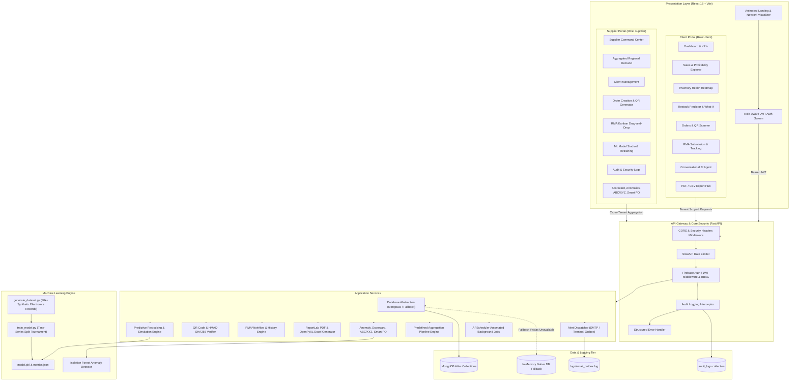
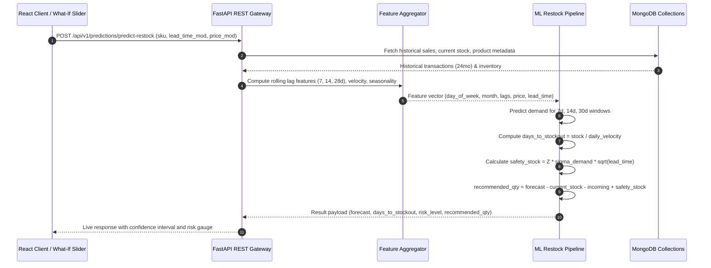

# System Architecture: ML-Powered Predictive Vendor & Procurement Platform

## 1. High-Level Architecture Overview

The platform connects wholesale electronics suppliers and retail store owners through a secure, multi-tenant architecture with strict role-based access control (RBAC), machine-learning-driven demand and stockout predictions, real-time supply chain tracking, grievance handling, and conversational business intelligence.

---

## 2. Multi-Tenant Security & Tenant Isolation

Tenant isolation is guaranteed by server-side claims enforcement:
1. Every authenticated request carries a signed JWT token containing custom claims:
   - `role`: either `client` or `supplier`
   - `store_client_id`: identifying the specific retail establishment (for `client` role)
2. In client routes (`/api/v1/client/*`), the query filter **always** binds `{"store_client_id": current_user.store_client_id}` extracted directly from the verified token payload.
3. Path or query parameters attempting to specify another store's ID are ignored or rejected with HTTP 403 Forbidden.
4. Supplier routes (`/api/v1/supplier/*`) require `role == 'supplier'`, granting authorized cross-store aggregation.

---

## 3. Data Pipeline & Machine Learning Architecture

---

## 4. Hardware and Supply Chain Verification (QR Code)

1. Orders generated by wholesalers produce a unique deterministic tracking hash:
   $$\text{hash} = \text{HMAC-SHA256}(\text{order\_id} + \text{store\_id} + \text{timestamp}, \text{SECRET\_KEY})[0:16]$$
2. QR codes encode public verification URLs (`/track/{hash}`).
3. Public tracking endpoint reveals only shipping milestones, carrier status, and timestamps. Sensitive financial, customer, or inventory data is stripped completely from unauthenticated responses.

---

## 5. Extensions Architecture

- **Anomaly Detection:** Scikit-learn Isolation Forest trained on transaction unit volume, return frequency, and gross margin variance to detect outliers, shrinkage, or supplier defects.
- **Supplier Scorecard:** Real-time multi-metric aggregation (On-Time Delivery, RMA Defect Ratio, Lead Time Deviation, Fill Rate) rendered as an interactive D3 / Recharts Radar graph.
- **Smart PO Workflow:** Transforms high-risk stockout predictions directly into a draft Purchase Order, provides approval lifecycle, and produces ReportLab-generated PO documents.
- **ABC/XYZ Matrix:** Classifies inventory using revenue contribution (Pareto 80/15/5) and demand variance coefficient of variation ($CV = \sigma / \mu$).
- **Live Notifications:** Server-Sent Events (SSE) channel pushing instantaneous inventory warnings, order transitions, and ticket updates to the top-bar notification bell.
